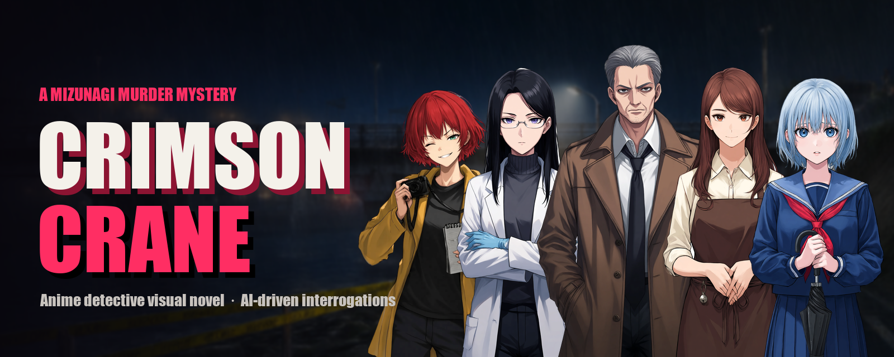
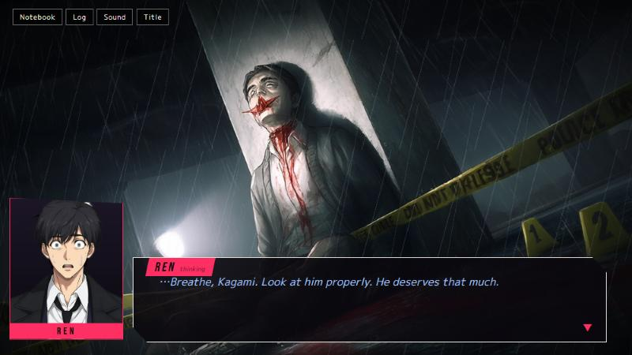
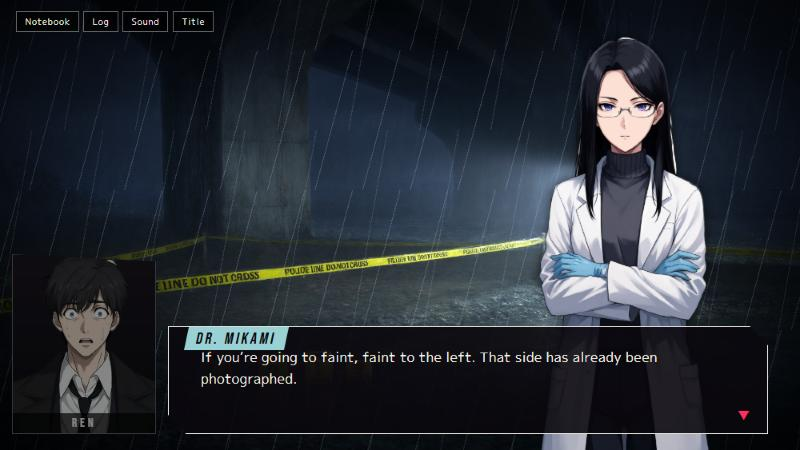
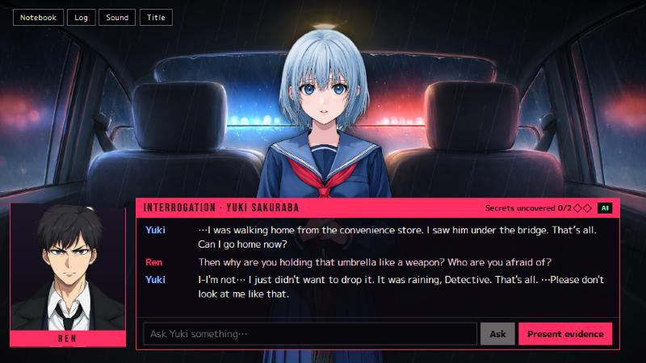
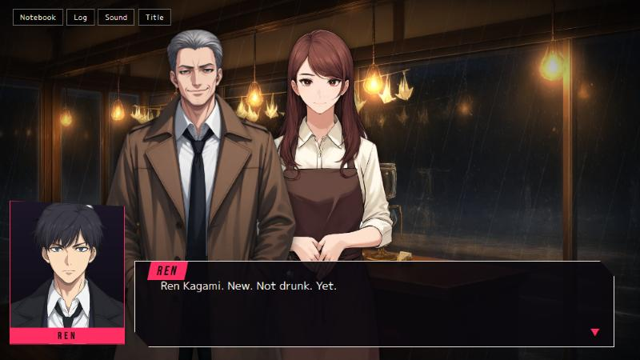

<p align="center">
  
</p>

# Crimson Crane

**An anime detective visual novel about a serial killer who leaves red paper cranes.**

Four bodies in nine weeks. Four red paper cranes. Rookie detective **Ren Kagami** arrives in the rain-soaked port town of Mizunagi on the night the fourth victim is found — and before dawn, the killer has already left a crane in *his* pocket.

Crimson Crane is a dark mystery in the spirit of *Danganronpa* and *Ace Attorney*. Investigate crime scenes, collect evidence, and interrogate witnesses who have something to hide: press them with questions until their story stops adding up, then present the evidence that breaks it.

| The fourth victim | The crime scene |
|---|---|
|  |  |
| **Interrogations** | **Café Lantern** |
|  |  |

> ⚠️ Contains depictions of violence and blood.

## Features

- **Interrogations** — characters lie, deflect and crack. New questions open up as their answers stop adding up, and the right evidence breaks a story fastest.
- **A fair mystery** — every clue you need is in front of you; you can solve it before Ren does.
- **The accusation** — in the final chapter the suspect argues every point, and you break each claim by presenting the right evidence.
- **Choices that matter** — two endings, plus smaller choices that change scenes along the way.
- **Case Notebook** — every clue and every person you meet, with a full dialogue log.
- **Event illustrations** — full-screen crime-scene artwork for the story's biggest moments.
- **Protagonist portrait** — Ren is always on screen in the corner, lighting up when he speaks and reacting to what he sees.
- **Anime art and atmosphere** — fully illustrated cast with expressions, rainy-night backgrounds, music, ambience and sound effects.
- **Fully offline** — all dialogue is hand-written; no accounts, no online services.
- **Autosave** and continue, volume settings, keyboard controls (Space / Enter).

## Status

| Chapter | Status |
|---|---|
| 1 — The Fourth Crane | ✅ Playable |
| 2 — Class 2-B | ✅ Playable |
| 3 — The Reflection Room | ✅ Playable |
| 4 — One Thousand Cranes | ✅ Playable |
| 5 — The Thousandth Crane | ✅ Playable — the accusation, two endings |

The whole story is playable from start to finish (about 1–1½ hours).

Read the full game description in **[docs/GAME_OVERVIEW.md](docs/GAME_OVERVIEW.md)**.

## Running it

Requires [Node.js](https://nodejs.org) (LTS).

```bash
npm install
npm run dev
```

Open http://localhost:5173 and click once to enable sound.

## Project layout

| Path | What |
|---|---|
| `src/game/script/` | Story script — scenes, dialogue, choices, music cues |
| `src/game/interrogations.ts` | Interrogations: questions, evidence reactions and secrets |
| `src/game/characters.ts`, `clues.ts` | Cast (incl. sprite files per emotion) and evidence |
| `src/game/store.ts` | Script engine, flags, clues, autosave |
| `src/game/audio.ts` | Music, ambience and sound effects |
| `public/` | Sprites, backgrounds, music and sound effects used by the game |
| `art-source/` | Original full-size art before background removal |
| `tools/` | Python helpers (background removal, comparison sheets, banner) and `check_script.ts`, which validates the whole story script |
| `docs/STORY_BIBLE.md` | ⚠️ **Spoilers** — the full truth of the case |
| `CREDITS.md` | Source and license of every art, music and sound file |

## Credits

Character art and backgrounds generated with [PixAI](https://pixai.art). Music and sound effects from [Pixabay](https://pixabay.com). Some interrogation lines were drafted with GLM (via OpenRouter) during playtesting and then edited by hand. Full list in [CREDITS.md](CREDITS.md).
