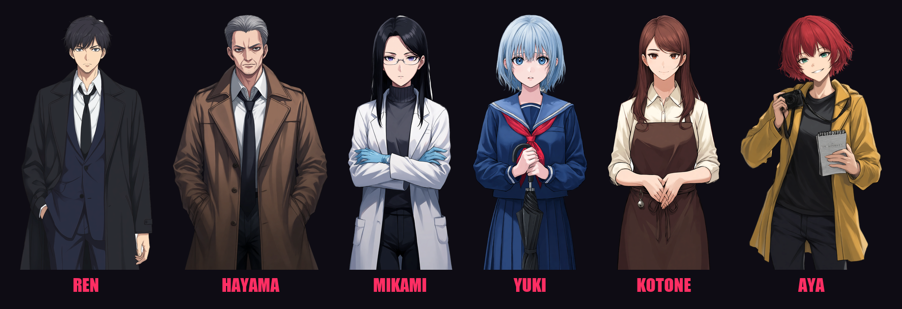

# Crimson Crane — Game Overview

> Spoiler-free. The full solution of the mystery is in [STORY_BIBLE.md](STORY_BIBLE.md) — don't open it if you want to play blind.

## At a glance

| | |
|---|---|
| **Genre** | Mystery / detective visual novel |
| **Style** | Anime art, dark noir atmosphere — inspired by *Danganronpa* and *Ace Attorney* |
| **Tone** | Dark and tense; crime scenes are described frankly, with moments of dry humor |
| **Player** | Detective Ren Kagami |
| **Setting** | Mizunagi, a rain-soaked Japanese port town, present day |
| **Length** | 5 chapters, about 1–1½ hours depending on how long you spend in interrogations |
| **Platforms** | Web (browser) today; PC and mobile builds planned |
| **Signature feature** | Interrogations where you press suspects with questions and evidence until their story breaks |

## The story

For nine weeks, a killer the newspapers call **the Crimson Crane** has stalked Mizunagi. Four victims — a pharmacist, a city councilman, a nurse, and now a retired schoolteacher — each found with a single precise wound and a **red paper crane** left on the body. Different ages, different jobs, different neighborhoods. No witnesses. No pattern anyone can see.

**Ren Kagami**, 24, transferred from Tokyo, was supposed to start work on Monday. At 1:12 a.m. on Saturday he's standing under Shirasagi Bridge in the rain, looking at the fourth victim — and at the faint printing that bleeds through the red dye of the crane: *Seiran Academy — Class 2-B.*

Partnered with a burnt-out veteran inspector, Ren has to work out what connects the victims before the next crane is folded. Everyone he meets is hiding something. Some of them are hiding the wrong things.

### Chapters

1. **The Fourth Crane** — the bridge, a frightened witness, a late-night café, and a message from the killer that ends the night.
2. **Class 2-B** — the crane paper leads to Seiran Academy, a girl who fell from a roof ten years ago, and a case file with a familiar signature.
3. **The Reflection Room** — Ren questions his own partner, breaks into a locked school building at night, and finds what a dead girl left behind.
4. **One Thousand Cranes** — a race against a deadline written on a door, a sound Ren has heard before, and a rooftop in the rain.
5. **The Thousandth Crane** — the accusation. Ren must prove who the Crimson Crane is, piece by piece, against someone who has an answer for everything. Two endings.

## Characters

| Character | Role |
|---|---|
| **Ren Kagami** (24) | The player. Quiet, observant, stubborn rookie detective. Still sleeps at night — for now. |
| **Daigo Hayama** (48) | Lead inspector on the case. Chain-smoking, exhausted, angrier at himself than at anyone else. |
| **Shiori Mikami** (31) | Medical examiner. Deadpan, precise, more polite to corpses than to people. |
| **Yuki Sakuraba** (17) | Seiran Academy student who found the fourth body. Quiet, sharp — and not telling the whole truth. |
| **Kotone Amane** (29) | Owner of Café Lantern, open late for exhausted cops. Warm, teasing, always folding paper cranes. |
| **Aya Tsukishima** (26) | Reporter for the Mizunagi Herald. Loud, nosy, and right more often than the police would like. |
| **Sadao Kirishima** (68) | Retired principal of Seiran Academy. Perfect manners, perfect suit, and a perfect record. |

## How it plays

### Story scenes
Classic visual novel presentation: illustrated characters over painted backgrounds, a typewriter dialogue box, Ren's inner thoughts, and dramatic effects (screen shake, red flashes, thunder) at key moments. Click, Space or Enter to advance.

- **Event illustrations** — the biggest moments, like the discovery of a victim, get a full-screen illustrated scene. The game does not shy away from blood.
- **Ren's portrait** — the protagonist is always shown in the bottom-left corner. It lights up when he speaks or thinks, and his expression (calm, serious, shocked) reacts to what he's seeing.

### Investigation
At crime scenes you choose what to examine — the body, the crane, the inspector's case notes. Each thread adds **evidence** to Ren's Case Notebook. Key conversations unlock once you've seen enough.

### Interrogation — the core mechanic
Witnesses and suspects have **secrets**. During an interrogation you:

- **Choose what to ask.** New questions open up as answers stop adding up, so you can press a lie further and further.
- **Present evidence** from the notebook to catch a lie ("Then explain *this*"). The right evidence breaks a story much faster than questions, and every character reacts to it in their own way.
- Watch the character's **expression change** as they react: nervous, angry, shocked, breaking down.

Every secret can be reached two ways, by the right line of questioning or by the right piece of evidence, so you can't get stuck. A progress tracker shows how many secrets remain. When everything is uncovered, the story moves on.

Every line is fixed in the game script, so it plays the same for everyone and runs fully offline, with no online services.

### The accusation
The final chapter plays like a trial. The suspect argues every point, and Ren answers each claim by **presenting the one piece of evidence that breaks it**, or by picking the right answer to a deduction. A wrong answer gets a counter-argument and another try.

### Case Notebook & Log
- **Evidence** — every clue with its full description; also used to present evidence during interrogations.
- **People** — portraits and profiles of everyone Ren has met.
- **Log** — the complete dialogue history.

## Art and audio direction

- **Visuals:** anime cel-shaded characters with multiple expressions each; painted backgrounds (train station, bridge crime scene, patrol car, Café Lantern, police station, morgue, Seiran Academy and its abandoned annex, a rooftop in the rain); full-screen event illustrations for the biggest moments; a black-and-hot-pink interface with slanted, comic-style panels.
- **Atmosphere:** constant rain, police lights, harsh floodlights against warm café light.
- **Music:** melancholic piano for the title, tense ambient investigation themes, eerie drones at the crime scene, a pulsing interrogation track, rainy-night lounge jazz at the café, a wistful school theme, a chase track for the rooftop, and a suspense theme for the accusation.
- **Sound:** rain ambience, thunder, door slams, an evidence chime, footsteps, a phone buzz, breaking glass, a very small silver bell, and impact stingers for the big reveals.

## Technology

| Part | Choice |
|---|---|
| Engine | Custom visual novel engine — React + TypeScript, built with Vite |
| State | Zustand; autosave to the browser |
| Art pipeline | PixAI (Tsubaki.3 Flash) for generation and expression edits; `rembg` (anime model) for background removal |
| Audio | Pixabay music and sound effects; crossfading music and ambience channels |

## Release plan

The game is fully scripted and offline, so it's free to run and the same for every player. During development, AI-played interrogations (GLM via OpenRouter) were used to playtest; the best lines were rewritten into the final, hand-written dialogue. Planned targets: web (itch.io), PC (Electron/Tauri → Steam / itch.io) and mobile (Capacitor → Google Play / App Store).

## Roadmap

- [x] Chapter 1 — story, investigation, interrogation, full art, music and sound
- [x] Chapters 2–5 — story, four new interrogations, the accusation, two endings
- [x] Art and music for Chapters 2–5
- [ ] Playtest pass and writing polish
- [x] Hand-written, offline interrogations (questions + evidence)
- [ ] Final music (licensed for commercial release)
- [ ] PC and mobile builds
